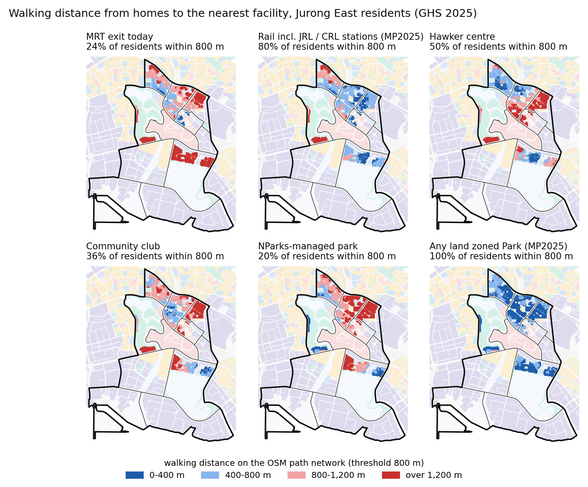

# Jurong East local area planning study

A reproducible study of **Jurong East** built from public Singapore data: land use and floor area under Master
Plan 2019 and 2025, walking access over the OpenStreetMap path network, gaps against the island-wide median, and a
build-out test of the residential land the plan zones but nobody yet lives on. The output is an 8-page planning
brief, [`report/brief.pdf`](report/brief.pdf) (source: [`report/brief.md`](report/brief.md)), with every result
table in [`outputs/`](outputs/).

- **Found:** 24 % of residents live within 800 m of an MRT exit (median 48 %), and 80 % will once the JRL and CRL
  stations open; 45 % are beyond the threshold for two or more of five neighbourhood facilities; building the four
  unoccupied residential plots adds about 31,600 residents, mostly beyond walking distance of a hawker centre,
  community club or primary school.
- **Limits:** residents are placed by zoning and floor area, not by block; OpenStreetMap under-maps covered
  linkways; the scenario tests the zoning and is not a forecast; CI checks the code and the committed outputs but
  does not download the data or rerun the pipeline.

This is an independent study, not a URA product.

## Why Jurong East

Three kinds of change overlap here:

- **Rail.** The Jurong Region Line adds Toh Guan, Jurong Town Hall and Pandan Reservoir stations (Stage 2; Stage 1
  was moved to mid-2028 in March 2026). Cross Island Line Phase 2 adds a Jurong Lake District station by 2032.
- **Plan.** Master Plan 2025, gazetted on 1 December 2025, brings housing into Jurong Lake District and plans a
  Jurong Gateway Hub.
- **Zoning.** About 66 ha of land zoned residential had essentially no residents in 2025.

## Headline findings

Jurong East had 72,950 residents in 2025, 25 % of them aged 65 or over. That is the SingStat planning-area total;
SingStat rounds subzone figures separately and they sum to 72,960, the base used for shares below. All figures come
from [`outputs/summary.json`](outputs/summary.json) and the CSVs next to it. "Median" means the median of the 32
planning areas with at least 10,000 residents.

| Finding | Jurong East | Median |
|---|---:|---:|
| Residents within 800 m of an MRT exit (29th of 32) | 24 % | 48 % |
| Same, counting JRL and CRL stations not yet open | 80 % | 59 % |
| Within 800 m of a hawker centre | 50 % | 26 % |
| Within 800 m of land zoned Park | 99.6 % | 98.9 % |
| Within 800 m of an NParks-managed park (lowest of 32) | 20 % | 67 % |

- **Rail.** Teban Gardens is at 0 % within 800 m of an MRT exit and Toh Guan at 6 %; the new stations would raise
  them to 89 % and 98 %.
- **Hawker centres.** Coverage is well above the median overall, but Toh Guan (13,510 residents) has none within
  800 m.
- **Community clubs.** Only 2 % of Toh Guan residents are within 800 m of one. A club at the planned Jurong Gateway
  Hub would lift that to 4 %: 96 % of Toh Guan residents would still be more than 800 m from any club.
- **Parks.** Estate parks are everywhere. Large parks are not: Jurong Lake Gardens sits at the western edge, so
  the NParks-managed measure is the lowest of the 32.
- **Combined gaps.** 32,700 residents (45 %) are beyond the threshold for at least two of five neighbourhood
  facilities: hawker centre, clinic, community club, zoned park and primary school (1 km).
- **Zoning change.** Permissible GFA on land with a numeric GPR rose from 1,660 ha in MP2019 to 1,786 ha in MP2025
  (+7.6 %, +127 ha). Most of that is land gaining a published GPR, not upzoning. In the parcel comparison, land
  that went from SDP, EVA or no GPR to a number adds 141.0 ha of GFA, land that lost its number removes 21.2 ha,
  and land with a number in both plans adds only 9.5 ha. (Changes under 0.25 ha are left out of the parcel table,
  so these parts sum to +129.4 ha.) MP2025 also turned 19.8 ha of reserve land at Jalan Papan and 3.6 ha in Toh
  Guan into residential land. 112 ha, including 76 ha of the Lakeside (Business) core, has no published GPR (SDP).
- **Scenario.** Building the four unoccupied residential plots at local densities adds about 31,600 residents; at
  plan capacity (100 m² per dwelling, 3.06 persons per household) the same floor area holds 59,900. Most of the
  new homes would be at Jalan Papan, beyond walking distance of any hawker centre, community club or primary
  school, even with direct paths. Teban Gardens Market would become the nearest hawker centre for 45,000
  residents, up from 19,400 (+132 %).

The brief turns these into five recommendations: a neighbourhood centre in the Jalan Papan plan, walking links
from Jalan Papan to the new stations, Toh Guan facilities at the JRL station, Teban Gardens walking and school review, and park
connectors to Jurong Lake Gardens.



## Data

All inputs are public and keyless. `python run_all.py --fetch` downloads them as its first step (or, after
`pip install -e .`, `python -m lap.fetch` downloads them alone) and writes [`data/sources.csv`](data/sources.csv)
with the URL, retrieval time, size and SHA-256 of every file. Raw files are not committed.

| Theme | Dataset (publisher) | data.gov.sg id / URL |
|---|---|---|
| Land use, GPR | Master Plan 2019 Land Use layer (URA) | d_90d86daa5bfaa371668b84fa5f01424f |
| Land use, GPR | Master Plan 2025 Land Use Layer (URA) | d_a8c3546b26712e35021f3a681d0353ae |
| Boundaries | MP2019 Subzone and Planning Area Boundary, No Sea (URA) | d_8594ae9ff96d0c708bc2af633048edfb, d_4765db0e87b9c86336792efe8a1f7a66 |
| Rail (planned) | Master Plan 2025 Rail Station Layer (URA) | d_2c06c9fe8ae724b5d33efa1f203e2c38 |
| Transport hubs | MP2025 SDCP Integrated Transport Hub layer (URA) | d_a5047ce23e02c5ca3aa56199d7d3eb59 |
| Population | Residents by planning area / subzone, age and sex, GHS 2025 (SingStat table C020123) | tablebuilder.singstat.gov.sg |
| Bus | LTA Bus Stop (LTA) | d_3f172c6feb3f4f92a2f47d93eed2908a |
| MRT | LTA MRT Station Exit (LTA) | d_b39d3a0871985372d7e1637193335da5 |
| Hawker centres | Hawker Centres (NEA) | d_4a086da0a5553be1d89383cd90d07ecd |
| Parks | NParks Parks and Nature Reserves (NParks) | d_77d7ec97be83d44f61b85454f844382f |
| Clinics | CHAS Clinics (MOH; last refreshed June 2024) | d_548c33ea2d99e29ec63a7cc9edcccedc |
| Community clubs | Community Club / PAssion WaVe Outlet (PA) | d_9de02d3fb33d96da1855f4fbef549a0f |
| Schools | General information of schools (MOE), postal codes geocoded with the OneMap search API (337/337) | d_688b934f82c1059ed0a6993d2a829089 |
| Walking network | OpenStreetMap, BBBike extract of Singapore | download.bbbike.org |

**Plan version.** The study started from Master Plan 2019, but Master Plan 2025 was gazetted on 1 December 2025 and
is the statutory plan now. The study therefore uses:

- MP2025 for current land use, unoccupied residential land and planned stations;
- MP2019 as the comparison baseline, and for subzone boundaries, because SingStat tabulates GHS 2025 residents on
  MP2019 boundaries.

## Method

**Residents.** Each MP2019 subzone's GHS 2025 residents are spread over its residential parcels in proportion to
parcel area × GPR (landed housing as 1.0; EVA and SDP parcels at their class median). Within each parcel they sit
on a 25 m lattice, giving 9,367 weighted points in Jurong East. Point weights add back to
the SingStat subzone totals.

**Walking network.**

- *Source.* OpenStreetMap ways parsed from the BBBike extract with the osmnx "walk" filter, except that park
  connectors tagged `highway=cycleway` with `foot=yes` or `designated` are kept.
- *Connectivity.* Only the largest connected component is used (87.5 % of nodes).
- *Joins.* Origins and destinations join the nearest node at their straight-line distance.
- *Shortest paths.* SciPy Dijkstra from a virtual source carrying every destination's join distance. The tests
  check it against `networkx` on random graphs.
- *Polygons.* Parks and future station boxes are entered at nodes on or near their edge, or from boundary points
  every 25 m.

**Thresholds** (all in `src/lap/config.py`):

| Destination | Walk | Source of the threshold |
|---|---:|---|
| Bus stop | 400 m | Usual bus catchment |
| MRT, park, hawker centre, clinic, community club | 800 m (10 min) | URA MP2025 counts households within a 10-minute walk of a station; NParks targets every household within a 10-minute walk of a park by 2030 |
| Primary school | 1 km | MOE P1 home-school distance band |

Shares at 600 m and 1 km are in `outputs/access_sensitivity.csv`.

**Benchmark.** Facilities are counted per planning area, park area is measured per resident, and coverage shares
are computed for every planning area. Jurong East's value, the median and its rank are in
`outputs/ratios_vs_island_median.csv`.

**Scenario.**

- *Plots.* MP2025 residential parcels of at least 2 ha in Jurong East with fewer than 10 residents per ha.
- *Residents.* Floor area (zoned GPR, or the area's median residential GPR of 2.8 on 75 % of an SDP site) divided
  by 61.9 m² of zoned residential GFA per resident, the density of Jurong East's existing estates.
- *Plan capacity.* The same floor area at 100 m² per dwelling and 3.06 persons per household (GHS 2025), i.e.
  32.7 m² per resident. This is a denser reading, not a ceiling: the sensitivity tables, which also vary GPR and
  dwelling size, go higher.
- *Intensified.* GPR 5.3, the highest residential GPR in the area, at the local density. It changes the GPR but
  keeps the lower density, so it can come out below plan capacity at today's GPR; the two cases are separate
  tests, not steps on one scale.
- *Access.* Measured on today's paths and "if connected" (straight line × 1.50, the detour ratio of existing
  homes).
- *Load.* Each facility's load is the number of residents for whom it is the nearest of its kind.

## Reproduce

Python 3.11 or later (CI uses 3.11; `pyproject.toml` states the same).

```bash
pip install -r requirements.txt
python run_all.py --fetch        # downloads about 0.55 GB, then about 10 minutes on a laptop
python -m pytest -q tests        # unit tests plus number checks on the committed outputs
python tests/mutate.py           # mutation check
```

`run_all.py` rebuilds `outputs/`, `report/figures/` and `report/brief.pdf`. The PDF step needs a Chromium-family
browser (Edge or Chrome) and is skipped without one. The brief text is written by hand from the outputs.
`tests/test_report_numbers.py` checks every number in this README's opening lines and *Headline findings* against
the outputs, each anchored to its sentence or table row, and fails on any number there that no check covers. In the
brief it checks a fixed list of headline numbers, not every number.

```
src/lap/   fetch, config, network, population, landuse, amenities, access, ratios, scenario, pipeline,
           figures, report
tests/     test_core.py (unit tests on hand-worked inputs), test_report_numbers.py, mutate.py
outputs/   result tables and summary.json        report/   brief.md, brief.pdf, figures/
```

## Tests and the mutation check

- **Unit tests.** `tests/test_core.py` checks every computational step on small hand-built inputs with
  hand-worked answers. Inputs are deliberately asymmetric, so that a swapped term or a dropped weight changes the
  result.
- **Mutation check.** `tests/mutate.py` plants 30 specific bugs, one at a time, and requires the suite to fail on
  each. Examples: `<=` turned into `<`, a dropped join distance, an unweighted share, a wrong age band, a reversed
  rank. It refuses to start unless the untouched suite passes. It counts a bug as caught only when at least one test
  fails and nothing errors; a mutant that causes a collection, import or setup error is reported as invalid and
  fails the check (`tests/test_harness.py` covers this rule).
- **Proof that the check can fail.** Before relying on it, it was run against a deliberately weakened suite and
  reported survivors with a non-zero exit (see *Mutation check log* below).
- **CI.** On every push, CI runs the tests on Ubuntu and Windows (Python 3.11) and the mutation check on Ubuntu.
  It checks the code and the committed outputs; it does not download the data or rerun the pipeline.

## Limits

- Residents are placed by zoning and floor area, not by block, so a zoned parcel that is still being built can
  receive some of its subzone's residents.
- OpenStreetMap under-maps void decks and covered linkways, so network distances lean long.
- Exits of stations not yet open are approximated by the edge of the MP2025 station box, which leans short.
- Facility layers have different vintages; the CHAS layer dates from June 2024.
- Facility counts within planning-area boundaries ignore cross-boundary use; the walking measures do not.
- The scenario tests the zoning; it is not a forecast. Its assumptions are varied in
  `outputs/scenario_plot*_sensitivity.csv`.

## Licence

- **Code:** MIT (see `LICENSE`).
- **Government data:** Singapore Open Data Licence (data.gov.sg) and SingStat terms.
- **Network-derived outputs:** © OpenStreetMap contributors, ODbL.

## Mutation check log

Proof that the check can fail, run on 2026-10-15 against a deliberately weakened copy of `test_share_within`
(the boundary value 400 m replaced by 300 m), with the `<=` to `<` mutant:

```
baseline: 89 tests pass
[07] access.py: SURVIVED  ('return float(weight[dist <= threshold].sum() / tot)')
0/1 mutants killed            -> exit 1
```

With the real test restored, the same mutant is killed (exit 0). The full run of all mutants is part of CI.
The first CI run caught a real weakness: mutant 24 (rank order reversed) survived, because the test's study area
ranked in the middle under either order. The test now also checks an area that ranks first, and all 28 mutants
of that list were killed. Two mutants added later (the weighted median and the GFA-change split) bring the list
to 30.
