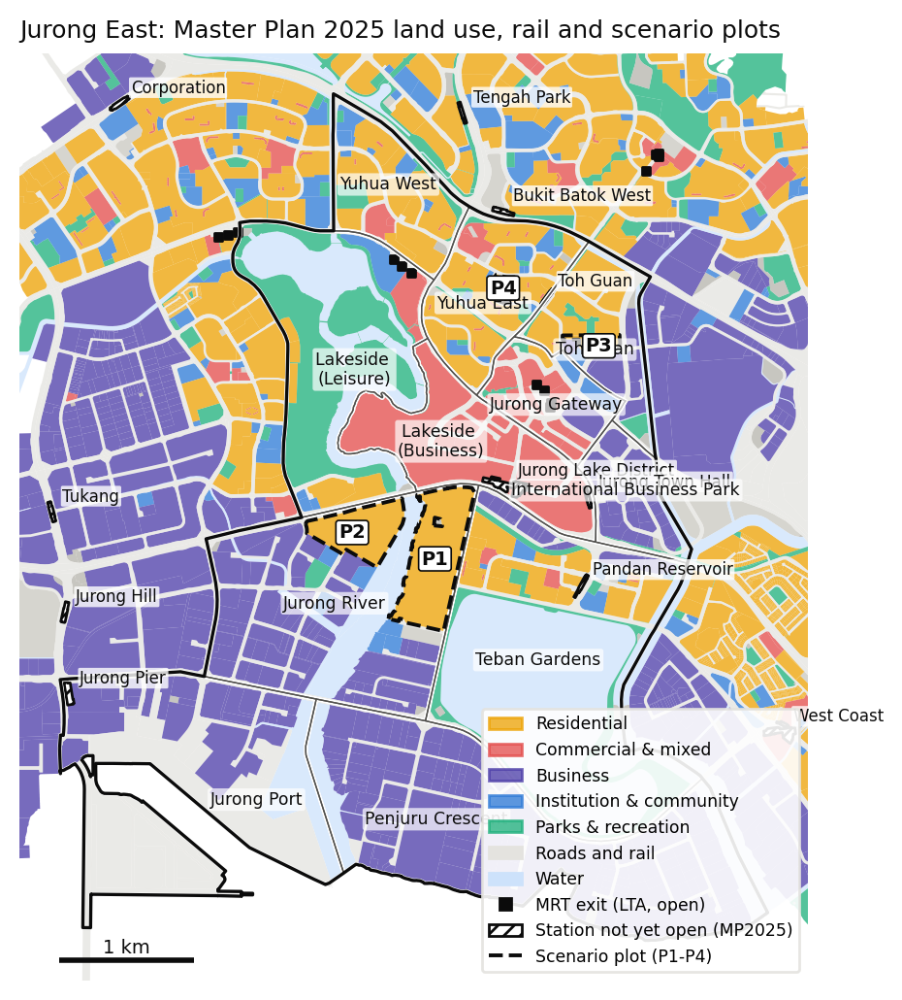
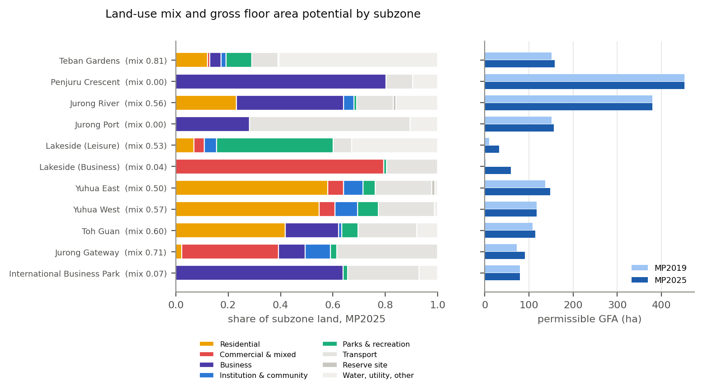
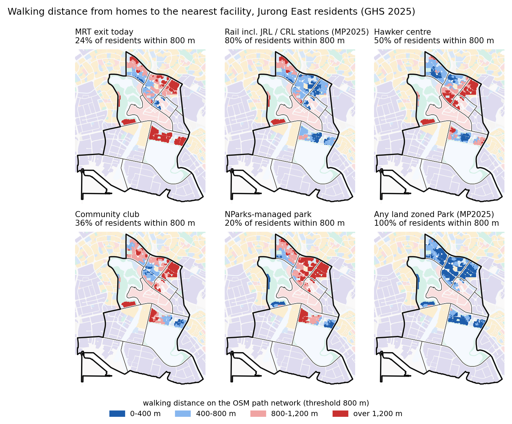
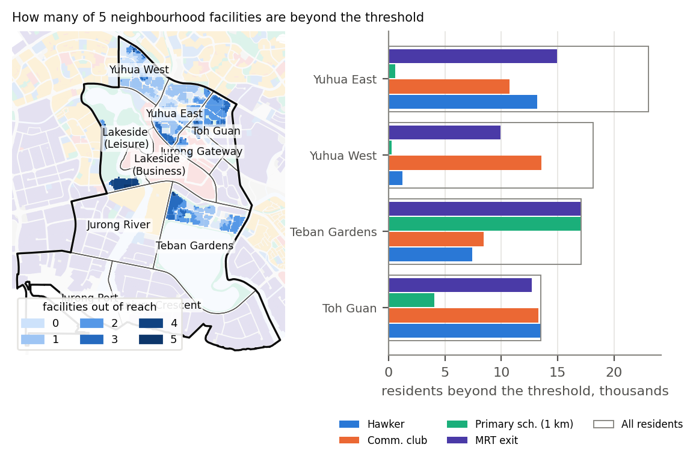
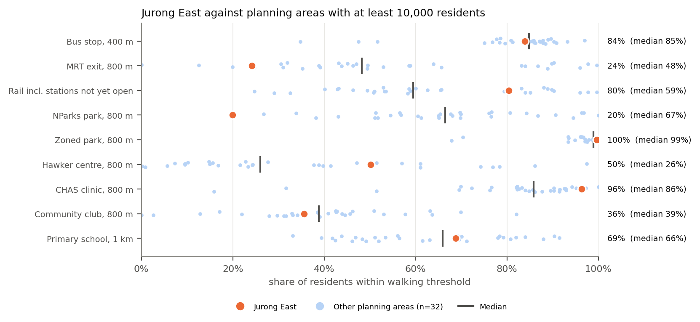
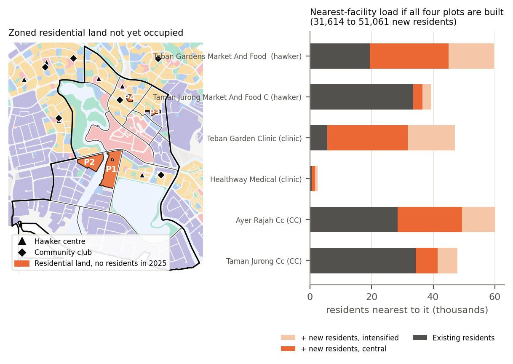

# Jurong East: Local Area Planning Brief

**Walking access, rail and the next wave of housing** · October 2026 · Wenjie Luo (independent study; not a URA document)

**Summary.** Jurong East has 72,950 residents (GHS 2025), a quarter of them aged 65 or over. Clinics, estate parks
and hawker centres are within easy reach of most homes. Rail is not: only 24 % of residents live within an 800 m
walk of an MRT exit, against a median of 48 % for planning areas with at least 10,000 residents. The Jurong Region Line (JRL) and
Cross Island Line (CRL) stations in Master Plan 2025 would lift this to 80 %. Two neighbourhoods carry most of the
remaining gaps. Toh Guan has no hawker centre and no community club within 800 m. Teban Gardens has no primary
school within 1 km and no station within 800 m until the JRL opens. The plan also zones about 66 ha of residential
land that housed no one in 2025, mostly at Jalan Papan in the Jurong River subzone. Built at local densities, that
land would add about 32,000 residents (up to 60,000 at full plan capacity), most of them beyond walking distance of
any existing hawker centre, community club or primary school. It is the area's main planning opportunity and its main risk.

## 1. Context

**Why this area.** Jurong East is the planning area in the West Region where land use, transport and housing are
changing together:

- **New rail.** URA's Master Plan 2025 (gazetted 1 December 2025) lists the JRL to open in stages from 2027 to
    2029. JRL Stage 2 adds Toh Guan, Jurong East, Jurong Town Hall and Pandan Reservoir stations. In March 2026 the
    Transport Ministry moved Stage 1 to mid-2028; Stage 2 dates are pending. CRL Phase 2 adds a Jurong Lake District
    station by 2032.
- **New housing and civic facilities.** The plan introduces housing in Jurong Lake District, and a Jurong Gateway
    Hub with a bus interchange, library and community club. It also lists a new or redeveloped polyclinic in Jurong
    East.

**Who lives here.** Residents live in four HDB-dominated subzones:

| Subzone | Residents | Residents 65+ |
|---|---:|---:|
| Yuhua East | 23,050 | 6,370 |
| Yuhua West | 18,170 | 4,440 |
| Teban Gardens | 17,100 | 4,210 |
| Toh Guan | 13,510 | 3,030 |

The other seven subzones hold fewer than 1,200 people between them. They are the regional centre (Jurong Gateway,
Lakeside) and industrial land (International Business Park, Jurong River, Jurong Port, Penjuru Crescent). Residents
aged 65 and over make up 25.2 % of Jurong East, against 18.8 % island-wide.

## 2. Land use and intensity

**Land-use mix.** Figure 2 shows each subzone's land split across five activity groups, scored from 0 (a single
use) to 1 (an even spread). The housing subzones score 0.50–0.60, Toh Guan at the top because business land sits
beside its blocks. Teban Gardens scores 0.81 because the index leaves out water, and Pandan Reservoir covers most of
the subzone. Lakeside
(Business), the core of Jurong Lake District, scores 0.04: almost all of it is commercial or white land.

**Permissible floor area.** Land area × gross plot ratio (GPR) gives the floor area the plan allows, not what is
built.

| | MP2019 | MP2025 | Change |
|---|---:|---:|---:|
| Permissible floor area (ha of GFA) | 1,660 | 1,786 | +7.6 % |
| Residential share (ha of GFA) | 604 | 648 | +7.1 % |

These totals cover only parcels with a numeric GPR. 112 ha has no published GPR (code SDP, "subject to detailed
planning"), including 76 ha of Lakeside (Business). The floor-area potential of the district core therefore cannot
be read from the Master Plan data.

**What changed between plans.** The parcel-level comparison (`outputs/zoning_changes_mp2019_mp2025.csv`) shows four
moves:

- 19.8 ha of reserve site at Jalan Papan (Jurong River) and 3.6 ha in Toh Guan became residential (SDP).
- 2.4 ha of educational land in Yuhua East became residential at GPR 3.5.
- 4.3 ha in Teban Gardens was upzoned from GPR 2.8–3.5 to 4.9–5.3.
- In Lakeside (Business), about 9.6 ha of white and commercial sites gained a numeric GPR (5.6–6.3) and 11 ha of
    white land became road.

## 3. Issues

**How access was measured.** Each subzone's residents were placed on its housing land in proportion to floor area.
Walking distance was then measured on the OpenStreetMap path network to the nearest facility of each type, with
two thresholds:

- 800 m (a 10-minute walk) for most facilities;
- 400 m for bus stops and 1 km for primary schools (the MOE P1 distance band).

Figure 5 compares Jurong East with the 31 other planning areas that have at least 10,000 residents.

**3.1 Rail access is the weakest link today.**

- Island-wide position: 24 % of residents live within 800 m of an MRT exit, 29th of 32 planning areas.
- By subzone: Teban Gardens 0 %, Toh Guan 6 %, Yuhua East 35 %, Yuhua West 45 %. Jurong East MRT sits in the
    commercial core, not among the housing.
- With the JRL and CRL: counting the edges of the Master Plan 2025 boxes for stations not yet open, coverage rises
    to 80 % (89 % in Teban Gardens and 98 % in Toh Guan). Yuhua West stays at 48 %.
- Timing: these gains arrive with JRL Stage 2, which has no confirmed date.
- Bus stops: 84 % of residents are within 400 m, close to the median of 85 %.

**3.2 Toh Guan: no hawker centre or community club within a 10-minute walk.**

- Hawker centres: none of Toh Guan's 13,510 residents live within 800 m of one. Across Jurong East the share is
    50 %, well above the island median of 26 %, so this is a local gap rather than an area-wide shortage.
- Community clubs: 2 % of Toh Guan residents are within 800 m, against 36 % for Jurong East and a median of 39 %.
- The planned Jurong Gateway Hub does not close this gap. Adding a community club at its Master Plan location
    raises Toh Guan's coverage only to 4 %: the hub is still a 1.3 km walk from the typical Toh Guan home.

**3.3 Teban Gardens: schools and rail.**

- No Teban Gardens resident is within 1 km of a primary school; Jurong East as a whole is at 69 %, median 66 %.
    The subzone has 1,350 children aged 5–14.
- 83 % of all Jurong East residents are within 2 km of a primary school.
- Teban Gardens is also the subzone with no MRT access until Pandan Reservoir and Jurong Town Hall JRL stations
    open.

**3.4 Parks: plenty of local green, but large parks sit at the edge.**

- Small parks: 99.6 % of residents live within 800 m of land zoned Park (median 98.9 %).
- NParks-managed parks: only 20 % do, the lowest of the 32 areas. Jurong Lake Gardens accounts for most of
    Jurong East's NParks park area (11.8 m² per resident, 6th of 32) and lies on the western edge.
- The gap is therefore access to a large park, not to green space in general.

**3.5 Combined gaps.** Five neighbourhood facilities were counted: hawker centre, CHAS clinic, community club,
zoned park and primary school.

- 32,700 residents (45 %) are beyond the threshold for two or more of them.
- They live mainly in Toh Guan (13,300), Teban Gardens (11,600) and Yuhua East (5,100) (Figure 4).
- Clinics are not part of the problem: 96 % of residents are within 800 m of a CHAS clinic, 3rd of 32.

## 4. Opportunities

**Zoned but unoccupied housing land.**

- *Which land.* Four Master Plan 2025 residential parcels of 2 ha or more had fewer than 10 residents per hectare
    in 2025, about 66 ha in total:
    - **P1:** Jalan Papan, 38.0 ha at GPR 3.5, already residential in MP2019;
    - **P2:** Jalan Papan, 21.2 ha, SDP;
    - **P3:** Toh Guan, 3.6 ha, SDP;
    - **P4:** Yuhua East, 3.0 ha at GPR 3.5.
- *Current use.* OpenStreetMap shows industrial buildings on P1 and P2 today.
- *Why it matters.* This land is the largest source of new homes in the area. It is also where the plan still
    leaves room for decisions, since P2 and P3 have no fixed GPR.

**Rail-led renewal.** The new JRL stations at Toh Guan and Pandan Reservoir serve two subzones that rail misses
today. Their station areas are natural places for the facilities those subzones lack.

**Existing upzoning.** The higher Teban Gardens GPRs (4.9–5.3) would add homes next to Pandan Reservoir station.

## 5. Scenario: building out and intensifying the unoccupied plots

**Assumptions.**

- Residents per hectare of floor area follow the area's own pattern. Existing Jurong East estates hold one resident
    per 61.9 m² of zoned residential GFA, since older blocks fall short of their zoned GPR.
- Plan capacity (100 m² GFA per dwelling, 3.06 persons per household, SingStat GHS 2025) is the upper bound.
- SDP plots take the area's median residential GPR (2.8) on 75 % of the site.
- The intensified case raises every plot to the highest residential GPR in the area (5.3).

**Results.**

| Plot | Area | GPR (MP2025) | New residents, central | Plan capacity | Intensified (GPR 5.3) |
|---|---:|---|---:|---:|---:|
| P1 Jalan Papan | 38.0 ha | 3.5 | 21,500 | 40,700 | 32,500 |
| P2 Jalan Papan | 21.2 ha | SDP | 7,200 | 13,600 | 13,600 |
| P3 Toh Guan | 3.6 ha | SDP | 1,200 | 2,300 | 2,300 |
| P4 Yuhua East | 3.0 ha | 3.5 | 1,700 | 3,200 | 2,600 |
| **All four** | 65.9 ha | | **31,600** | 59,900 | 51,100 |

**Effect on accessibility.** Walking distances from P1 and P2 were measured twice: on today's paths, and assuming
the plots get direct paths (straight-line distance × 1.50, the detour ratio measured for existing Jurong East
homes).

- *Today's paths.*
    - From the centre of P2, the CRL Jurong Lake District station box is a 4.2 km walk, although the plot edge is
        0.6 km from it in a straight line: no mapped paths cross the land in between.
    - None of P1 or P2 is within 800 m of a hawker centre, community club or primary school.
- *With direct paths.*
    - P1 gains rail within 800 m on only 34 % of the site; P2 on none of it.
    - Hawker-centre, community-club and primary-school access stays at zero for both: the nearest ones are simply
        too far.
- *P3 and P4.* These fit the existing network: almost all of both sites is within 800 m of a JRL station. P4 has
    most neighbourhood facilities within reach (a hawker centre from 69 % of the site, a community club from 88 %).
    P3 shares Toh Guan's hawker-centre and community-club gap.

**Effect on demand.** Existing residents were assigned to their nearest facility; new residents to the nearest by
straight line. With all four plots built (central case):

| Nearest facility | Residents today | After build-out | Change | Intensified |
|---|---:|---:|---:|---:|
| Teban Gardens Market and Food Centre | 19,400 | 45,000 | +132 % | +208 % |
| Ayer Rajah Community Club | 28,400 | 49,400 | +74 % | +112 % |
| Teban Garden Clinic | 5,600 | 31,700 | +467 % | +739 % |

Read the clinic figure with care: CHAS clinics are private GP practices (26 in Jurong East) that can open where
demand grows. Hawker centres and community clubs are planned public facilities, so their loads are the ones the plan
has to answer for.

## 6. Recommendations

1. **Plan a neighbourhood centre within the Jalan Papan land (P1–P2) before it is released for housing.** It should
      include a hawker centre, a community club or satellite, sites for a primary school and preschools, and space
      for clinics. It should be sized for 30,000–50,000 residents and phased with the first completions. Without it,
      about 29,000–46,000 new residents (central and intensified cases) would lean on Teban Gardens Market, Ayer Rajah
      CC and schools more than 2 km away.
2. **Secure direct pedestrian links from Jalan Papan to the CRL Jurong Lake District, JRL Jurong Town Hall and
      Pandan Reservoir stations, as a condition of the P2 detailed plan.** On today's paths the CRL station is a
      4.2 km walk from the centre of P2, although the plot edge is 0.6 km from it in a straight line.
3. **Use the Toh Guan JRL station area and the 3.6 ha P3 site to add community and food facilities in Toh Guan.**
      Toh Guan's 13,510 residents have neither a hawker centre nor a community club within 800 m. A community club at
      the Jurong Gateway Hub would raise coverage there only from 2 % to 4 %.
4. **Make first- and last-mile walking to Pandan Reservoir and Jurong Town Hall JRL stations a Friendly Streets
      priority in Teban Gardens. Ask MOE to review primary school provision there alongside the Jalan Papan plan.** No
      Teban Gardens resident is within 1 km of a primary school, and the subzone has 4,210 residents aged 65 and over
      who will depend on the new stations.
5. **Extend park connector links from Toh Guan and Yuhua East to Jurong Lake Gardens.** Estate parks are within
      800 m of nearly every home, but only 20 % of residents are within 800 m of an NParks-managed park, the lowest
      share of the 32 areas compared.

## 7. Implementation and stakeholders

| Horizon | Actions | Lead and partners |
|---|---|---|
| 0–2 years | Detailed planning brief for P2 and P3 (SDP), with a social-facility schedule and pedestrian network; walking audits around Toh Guan and Pandan Reservoir stations | URA with HDB, LTA, NEA, PA, MOE, MOH |
| 2–5 years (JRL Stage 2, CRL 2032) | Station-area links and covered walkways; Friendly Streets in Teban Gardens and Toh Guan; Jurong Gateway Hub | LTA, URA, town council |
| 5–15 years | Phased release of Jalan Papan; neighbourhood centre built ahead of or with first completions; transition of existing industrial occupiers | URA, HDB, SLA and JTC (land and leases), NEA, PA, MOE |

**Engagement.**

- Residents of Teban Gardens and Toh Guan, through the town council and grassroots organisations, on the location
    of new food and community facilities.
- Existing industrial occupiers at Jalan Papan, on relocation timelines.
- The Jurong Lake District stakeholders, on the pedestrian links across Lakeside (Business).

**Risks.**

- JRL Stage 2 dates are unconfirmed, and Stage 1 has already slipped six months.
- If housing at Jalan Papan comes before its facilities, the demand shifts shown in Section 5 fall on facilities
    already serving Teban Gardens.

## 8. Method notes and limits

**Data.** All public, retrieved 15 October 2026 (`data/sources.csv` records the URL, time and SHA-256 of each
file):

| Source | Data |
|---|---|
| URA Master Plan 2019 and 2025 | Land use, subzones, rail stations, integrated transport hubs |
| SingStat GHS 2025, table C020123 | Residents by subzone and age |
| LTA (data.gov.sg) | Bus stops and MRT exits |
| NEA, MOH, PA, MOE, NParks | Hawker centres, CHAS clinics, community clubs, schools, parks |
| OpenStreetMap (BBBike extract) | Walking network |

**Known limits.**

- *Where residents are placed.* Residents are spread over residential land by floor area, not by block.
- *Network.* OpenStreetMap under-maps void decks and covered linkways, so network distances lean long.
- *Unopened stations.* Distances to stations not yet open use the edge of the Master Plan station box, since exit
    locations are not published. This leans short.
- *Facility data.* The CHAS layer was last updated in June 2024. Counts in planning-area boundaries ignore
    facilities across the boundary; the walking measures do not.
- *Scenario.* The scenario is a test of the zoning, not a forecast. Dwelling sizes, GPRs for SDP land and phasing
    are assumptions, and each is varied in `outputs/scenario_plot*_sensitivity.csv`.

**Sources.**

1. URA, Master Plan 2025, West Region, "More convenient and connected homes": https://www.ura.gov.sg/land-planning/master-plan/master-plan-2025/regional-plans/west/more-convenient-and-connected-homes/
2. URA, Gazette of Master Plan 2025 (circular, 1 December 2025): https://www.ura.gov.sg/guidelines/circulars/ppg25-12/
3. Committee of Supply debate 2026, public transport (JRL Stage 1 moved to mid-2028): https://landtransportguru.net/committee-of-supply-debate-2026-public-transport-offerings
4. NParks, City in Nature (every household within a 10-minute walk of a park by 2030): https://nparks.gov.sg/about-us/city-in-nature
5. MOE, Primary 1 registration, home–school distance bands: https://www.moe.gov.sg/primary/p1-registration/distance
6. SingStat, General Household Survey 2025 (average household size 3.06): https://www.singstat.gov.sg/find-data/explore-data-themes/households/resident-households/latest-news-data
7. Dataset pages on data.gov.sg and the SingStat Table Builder, as listed in `data/sources.csv`.
